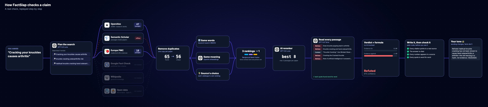

<p align="center">
  
</p>

<h1 align="center">FactSlap</h1>

<p align="center">
  Fact-check any claim against published research. Every sentence is cited, every quote is checked.
</p>

<p align="center">
  <a href="https://www.factslap.app"></a>
  <a href="https://github.com/73bruno/factslap/actions/workflows/ci.yml"></a>
  
  <a href="LICENSE"></a>
</p>



<p align="center"><sub>A real check, as the site's "How it works" view shows it.</sub></p>

## How it works

1. **Plan.** A fast model turns the claim into scientific search queries and picks the sources that fit.
2. **Search.** OpenAlex, Semantic Scholar, Europe PMC, Google Fact Check, Wikipedia, World Bank and Open Food Facts, in parallel. A source that fails is skipped, never fatal.
3. **Rank.** Duplicates are removed; BM25, embeddings and each source's own order are fused with Reciprocal Rank Fusion; an LLM reranker keeps the best 8, at most two per paper.
4. **Read.** Each passage gets a stance (supports, refutes, context) and one sentence quoted word for word. No exact quote, no vote.
5. **Verdict.** A formula, not a model: the stances weighted by study design (meta-analysis > trial > observational…), with at least two independent papers on the winning side.
6. **Write and verify.** Every factual sentence is cited. Plain code checks that the citations exist, the quotes are verbatim and every number appears in a source; if a check fails, the answer is rewritten once with the errors.
7. **Tone.** Academic, casual or Mic Drop. Only the wording changes: a rewrite that touches a citation or a number is thrown away.

## Design choices

- **No "what do you want to hear" option.** The first version let users pick "debunk this" and passed it to the verdict prompt. Now the verdict comes from the evidence alone.
- **Correlation is not causation, in the prompt.** Without it, an early version said sugar makes kids hyperactive.
- **Untrusted text stays data.** Claims and passages are wrapped in tags, and instructions inside them are ignored.
- **It degrades gracefully.** Without embeddings, the reranker or the index, the rest still works.

## Results

On 30 hand-labelled myths and facts in English and Spanish (`make eval-myths`), 24 verdicts are right and every answer passes the checks. Of the 6 misses, 4 are too cautious and 2 go the wrong way.

`make test` runs 54 tests offline, with a fake LLM and mocked APIs.

## Run it

```bash
uv venv --python 3.12 .venv && uv pip install -e ".[dev]"
cp .env.example .env   # only OPENAI_API_KEY is required
python -m factslap "Cracking your knuckles causes arthritis" --tone aggressive
```

Web app: `uvicorn factslap.api:create_app --factory --port 8000`, then `npm install && npm run dev` (http://localhost:5173).

In production the API has hard limits in Upstash Redis: one check per person per hour, 50 a day in total, a daily spend cap and a 7-day cache. It deploys to Vercel as the Vite app plus one Python function.

## Stack

Python · FastAPI · OpenAI · Upstash Redis · Supabase pgvector (optional index) · React · Vite · Tailwind · Vercel

## License

MIT. The fonts keep their own licences (OFL, Apache 2.0), included next to them.
