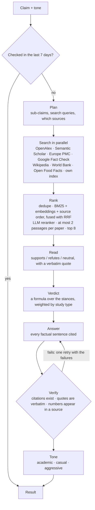

# FactSlap

Fact-check a claim against published research. FactSlap searches papers, fact-checks and open data in parallel, reads what each passage says about the claim, decides the verdict with a formula, and writes an answer where every sentence is cited and checked. A tone rewrite can make it casual or argumentative, but it can't change the facts.

Live at [factslap.app](https://www.factslap.app).


## How it works



- **Plan** (`stages.py`): one structured call returns the language, the atomic sub-claims, two or three scientific search queries and the sources that fit.
- **Search** (`sources/`): every source is an adapter with the same `search(...) -> list[Passage]` interface. They run in parallel with a timeout and retries; a failing source is reported, never fatal.
- **Rank** (`retrieval/`): three rankings (the source's own order, BM25 and embedding similarity) are fused with reciprocal rank fusion, the top 30 go to a listwise LLM reranker, and the best 8 are kept with at most two passages from the same paper.
- **Read** (`stages.py`): each passage gets a stance and one sentence quoted word for word. If the quote isn't in the passage, the passage doesn't count.
- **Verdict** (`stages.decide`): no LLM. Supporting and refuting weight, by study type (meta-analysis > trial > observational…). One side must clearly win, with at least two independent papers; otherwise the verdict is *not enough evidence*. Confidence is agreement × strength, and the explanation says how it was reached.
- **Answer and verify** (`verify.py`): the answer explains the verdict it is given and cites `[n]` for every factual sentence. Plain code checks every citation, quote and number before the answer is shown.
- **Tone**: academic, casual or Mic Drop only changes the wording. The rewrite is thrown away if it changes a citation or a number.

Models: `gpt-5.6-luna` for planning and reranking, `gpt-5.6-terra` for reading, answering and tone, `gpt-5.4-mini` as fallback and `text-embedding-3-small` for embeddings. All can be changed in `.env`.

## Design decisions

- **The verdict comes before the tone.** The first version let the user pick a goal ("debunk this") and put it into the verdict prompt. Here there is no goal to pick: the verdict is computed from the evidence alone, and tone is a separate, checked rewrite.
- **Correlation is not causation.** The reader prompt says an association alone does not prove a causal claim; the first version said sugar makes kids hyperactive because it read observational studies as proof.
- **Untrusted text stays data.** Claims and retrieved passages are wrapped in tags and the model is told to ignore instructions inside them.
- **Optional services degrade gracefully.** No embeddings: BM25 and source order only. Reranker off: fused ranking. No index: live sources only.
- **One pipeline.** An async generator yields each step and then the result; the streaming endpoint, the plain endpoint, the CLI and the evaluation all consume it.

## Limits and cost

A check costs about 2 cents, so the public API has hard limits, all enforced atomically in Upstash Redis (`limits.py`):

- one check per person per hour (IPs are stored only as salted hashes);
- 50 checks a day for everyone together, and at most 4 at the same time;
- a daily budget: each check reserves its worst-case cost up front and is corrected to the real cost afterwards;
- the same claim and tone within 7 days is answered from a cache at no cost;
- if Redis is unreachable the API refuses (fail closed), and requests are only accepted from the site's own origin.

## Share links

A verified result gets an 8-character id. `/c/{id}` serves the Open Graph tags and redirects to the result page `/r/{id}`; the preview image is drawn on the fly with Pillow (`share.py`, `/api/v2/share/{id}/card.jpg`). Links last 180 days.

## Evaluation

```bash
make eval-myths       # 30 hand-labelled myths and facts, 23 in English and 7 in Spanish
make eval-retrieval   # SciFact: does the live search return the gold paper? (recall@k, MRR, nDCG)
```

The myths run is end to end: verdict accuracy and macro-F1, answers that pass every deterministic check, faithfulness from an LLM judge, latency and cost. Latest run (20 Oct 2026): 24 of 30 verdicts right and all 30 answers passed the checks, with a median of 18 s and $0.017 per claim. Of the six misses, four were too cautious (*mixed* or *not enough evidence*) and two went the wrong way (reading in dim light, coffee and children's growth).

`make test` runs 54 tests with no network and no keys: sources are mocked with `respx` and the LLM is a fake keyed by output schema. CI runs `ruff` and `pytest` on every push.

## Run it

```bash
uv venv --python 3.12 .venv && uv pip install -e ".[dev]"
cp .env.example .env   # OPENAI_API_KEY is the only required key
python -m factslap "Cracking your knuckles causes arthritis" --tone aggressive
```

The CLI prints each step, the verdict, the cited quotes, the checks, the latency and the cost. For the web app:

```bash
uvicorn factslap.api:create_app --factory --port 8000
npm install && npm run dev   # http://localhost:5173, proxies /api to :8000
```

Without the Upstash variables the local API runs without limits, cache or share links (on Vercel it refuses instead). API: `POST /api/v2/check-stream` streams each step as Server-Sent Events and then the result; `POST /api/v2/check` returns the result only. Both take `{"claim", "tone"}`.

To deploy on Vercel, set the variables from `.env.example` in the project. `vercel.json` builds the Vite app and serves the FastAPI app from one Python function (`api/index.py`). The own index and semantic cache are optional: create a Supabase project and run `supabase/migrations/0001_index.sql` (pgvector, full-text search and a `hybrid_search` function with RRF).

## Layout

```
factslap/
  sources/     one adapter per source
  retrieval/   BM25, reciprocal rank fusion, embeddings and the ranker
  llm/         OpenAI client with structured output, fallback and a per-request cost meter; prompts
  stages.py    plan, stance, verdict, answer, tone, judge
  verify.py    deterministic answer checks
  pipeline.py  the orchestrator
  limits.py    rate, spend and concurrency limits, result cache
  share.py     share links and the preview card
  api.py       HTTP endpoints
eval/          datasets, metrics, runner
tests/
src/           web app (React, Vite, Tailwind)
supabase/      SQL migration for the optional index
```

## Limitations

- Sub-claims are planned, but the verdict is given for the claim as a whole.
- Europe PMC is used for abstracts only.
- The study-type weights are set by hand; the evaluation is how they get tuned.
- The web app is in English. Claims in other languages are answered in their language, but only Spanish is evaluated.
- It summarises published research and can be wrong. It is not medical, legal or financial advice.

## License

MIT. The fonts in `factslap/assets` and `public/fonts` keep their own licences (SIL Open Font License and Apache 2.0), included next to them.
